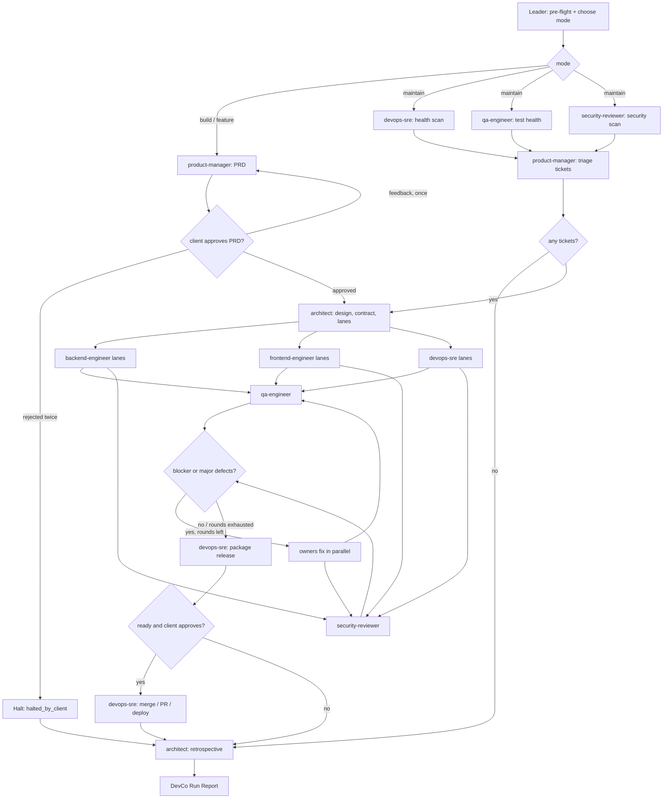

# Workflow: request or health signal → PRD/backlog → design → parallel build → isolated verify/fix → release → retro

## Overview



## Args

| Arg | Type | Default | Meaning |
|---|---|---|---|
| `request` | str | — | Brief, feature request, or maintenance focus |
| `mode` | str | `build` if request else `maintain` | `build` \| `feature` \| `maintain` |
| `project_dir` | str | `./devco-app` | Absolute repository path (strongly recommended) |
| `stack` | str | — | Stack preference for greenfield builds |
| `branch` | str | `devco/<mode>` | Run branch all roles commit to |
| `auto_approve` | bool | `false` | Skip human gates; ship only if verification is clean |
| `max_fix_rounds` | int | `2` (0–3) | Verify → fix iterations |
| `max_tickets` | int | `5` (1–8) | Maintenance tickets per sweep |
| `signals` | str | — | Maintain mode: CI logs, error reports, issue list |
| `models` | dict | — | Model per role or group: keys `default`, `planning`, `engineering`, `review`, or any role id / alias. Values are team model pool names |
| `agent_types` | dict | — | External CLI worker per role or group (`claude`, `codex`) |
| `available_models` | list | — | Team model pool names; routed names outside this list are dropped before the run |

**Model routing.** For each role, the model comes from its role key, then its group key, then `default`, and otherwise the team default model. Each agent call tries a fallback chain: the routed options, then the external CLI's own model (only when both `agent_type` and `model` are set), then the team default model. Every fallback is logged and reported in `model_fallbacks`; the resolved assignment is reported as `model_plan`. The per-project source of truth is `.devco/models.yaml` ([template](templates/models.yaml)).

Project memory lives in `<project_dir>/.devco/`: `PRD.md`, `DESIGN.md`, `api/`, `BACKLOG.md`, `HEALTH.md`, `reports/qa.md`, `reports/security.md`, and `PLAYBOOK.md`.

## Detailed Steps

### Step 0 — Pre-flight: dependency check

- **Executor**: Leader
- **Input**: [dependencies.yaml](dependencies.yaml), user args
- **Action**: verify that git is present (plus python/node/docker as the stack requires) and that `project_dir` exists or can be created. If `.devco/PLAYBOOK.md` is missing, seed it from [templates/PLAYBOOK.md](templates/PLAYBOOK.md).
- **Output**: pre-flight report
- **Quality gate**: the user decides go/no-go on missing items

### Step 1 — Intake (build / feature)

- **Executor**: product-manager, then client
- **Input**: `request`, existing repo (feature mode), playbook
- **Action**: write and commit `.devco/PRD.md`. The client approves it or gives feedback, and the PM revises once.
- **Output**: PRD (`title`, `user_stories[]`, `acceptance_criteria[]`, `non_goals[]`, `open_questions[]`)
- **Serial / Parallel**: serial
- **Quality gate**: ≥ 1 acceptance criterion, otherwise one automatic retry. If the client rejects twice or gives no answer, set `halted_by_client` and skip to the Retrospective.

### Step 1' — Intake (maintain)

- **Executor**: devops-sre ∥ qa-engineer ∥ security-reviewer, then product-manager
- **Input**: repo, `signals`, playbook "Recurring maintenance focus"
- **Action**: three isolated health scans, then triage into ≤ `max_tickets` tickets. Deferred items go to `.devco/BACKLOG.md`.
- **Output**: `findings[]` per scanner; `tickets[]`
- **Serial / Parallel**: the scans run in parallel; triage is serial
- **Quality gate**: a missing scanner adds a warning and the run continues. Zero tickets sets status `healthy` and skips to the Retrospective.

### Step 2 — Architecture

- **Executor**: architect
- **Input**: PRD or tickets, stack preference
- **Action**: commit `.devco/DESIGN.md` and the API contract, scaffold the layout, and emit lanes.
- **Output**: `stack`, `api_contract`, `data_model`, `lanes[]` (`id`, `owner`, `title`, `scope`, `paths[]`)
- **Serial / Parallel**: serial
- **Quality gate**: zero lanes triggers the default backend/frontend/devops lanes, with a warning. More than 12 lanes are capped, and the rest are deferred.

### Step 3 — Build

- **Executor**: backend-engineer ∥ frontend-engineer ∥ devops-sre (only owners that have lanes)
- **Input**: that owner's lanes plus the shared contract
- **Action**: implement, test and commit per lane, inside the lane's paths only.
- **Output**: `files_changed[]`, `tests_added[]`, `test_command`, `verdict`
- **Serial / Parallel**: parallel
- **Quality gate**: an owner with no usable result is recorded as `blocked`. Verification still runs and will surface the gap.

### Step 4 — Verify & Fix

- **Executor**: qa-engineer ∥ security-reviewer, then the owning engineers
- **Input**: requirements, contract, build results, fix round
- **Action**: isolated reviews. Blocker and major defects are grouped by owner and fixed in parallel, each with a regression test, then the branch is re-reviewed.
- **Output**: `defects[]` per reviewer; fixes per owner
- **Serial / Parallel**: reviews run in parallel, fixes run in parallel, rounds run in series
- **Quality gate**: stop when no blocker/major defects remain or `max_fix_rounds` is reached. If both reviewers fail, a synthetic blocker `REVIEW-MISSING` is raised, which prevents shipping.

### Step 5 — Release

- **Executor**: devops-sre, client
- **Input**: build results, unresolved blockers
- **Action**: package the release (CI, containers, `.env.example`, README, notes). Ship only with client approval, or with `auto_approve` and a clean verification. Shipping means opening a PR or merging per convention, plus approved deploy steps.
- **Output**: `release_notes`, `run_instructions`, `deploy_steps`, and the shipped record
- **Serial / Parallel**: serial
- **Quality gate**: `ready` requires zero unresolved blockers. Otherwise the status is `needs_attention`.

### Step 6 — Retrospective and Final Report

- **Executor**: architect (tech lead); the Leader assembles the report
- **Input**: status, warnings, fix history, blockers
- **Action**: rewrite and commit `.devco/PLAYBOOK.md`.
- **Output**: `lessons[]`, `playbook_updates[]`, `skill_improvements[]`, `next_maintenance_focus[]`
- **Quality gate**: always runs, including after a halt or a healthy result

**Final Report format** (the Leader renders it from the script's return value):

```markdown
# DevCo Run Report — <mode> — <status>
**Project**: <project_dir>  **Branch**: <branch>

## Scope
<PRD title + acceptance criteria, or the maintenance tickets>

## What was built / fixed
<per owner: verdict, files_changed, tests_added, test_command>

## Verification
<per round: blocking/total defects; QA vs security disagreements quoted verbatim>

## Unresolved blockers
<verbatim list, or "none">

## Release
<release notes, run instructions, shipped? how?>

## Retrospective
<lessons; playbook updates; proposed skill improvements; next maintenance focus>
```

## Acceptance Criteria

- Every executed phase produced structured output, or a logged warning explaining its absence
- No code was written before PRD approval (build/feature), unless `auto_approve`
- Engineers' `files_changed` stay within their lane paths
- Nothing shipped while blocker/major defects were open
- `.devco/PLAYBOOK.md` was updated by the retrospective
- The report's status is one of `shipped`, `ready_awaiting_ship`, `needs_attention`, `healthy`, `halted_by_client` or `degraded`
